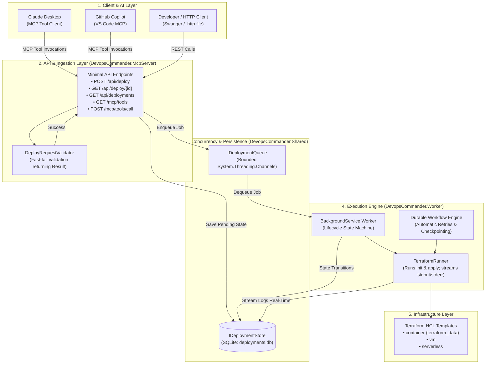

# DevOps Commander 🚀

> 📖 **Have an exam or viva today? Check out the [Complete Viva & Exam Guide (Simple English)](VIVA_GUIDE.md)!**

> **AI-Powered DevOps Infrastructure Orchestrator built with .NET 10, Minimal APIs, System.Threading.Channels, SQLite, and Terraform.**

DevOps Commander is an autonomous infrastructure provisioning engine implementing the **Model Context Protocol (MCP)**. It bridges AI assistants (such as **GitHub Copilot** and **Claude Desktop**) with automated cloud infrastructure pipelines, executing, streaming, and auditing cloud deployments via Terraform.

---

## 🏛️ System Architecture



---

## 📂 Project Structure

```
Devops-commander/
├── src/
│   ├── DevopsCommander.Shared/           # Core models, interfaces, Result<T>, and infrastructure
│   │   ├── Models/                       # DeployRequest, DeployResponse, DeploymentState, DeployStatus
│   │   ├── Interfaces/                   # IDeploymentStore, IDeploymentQueue, ITerraformRunner, IDeploymentWorkflowEngine
│   │   ├── Infrastructure/               # SqliteDeploymentStore, ChannelDeploymentQueue, TerraformRunner, DurableWorkflowEngine
│   │   └── Validation/                   # DeployRequestValidator
│   ├── DevopsCommander.McpServer/        # ASP.NET Core Minimal API & AI MCP tool server
│   │   ├── Program.cs                    # Route definitions, DI registration, and hosted service
│   │   └── DevopsCommander.McpServer.http# Interactive requests runnable directly in VS Code / Visual Studio
│   └── DevopsCommander.Worker/           # BackgroundService queue consumer and lifecycle orchestrator
│       └── Worker.cs                     # Dequeues jobs, drives state machine, updates SQLite
├── templates/
│   └── terraform/                        # Infrastructure templates
│       ├── container/                    # Container cluster template (main.tf)
│       ├── vm/                           # Virtual machine compute template (main.tf)
│       └── serverless/                   # Serverless function template (main.tf)
├── tests/
│   └── DevopsCommander.Tests/            # Automated test suite (xUnit)
│       ├── ResultTests.cs                # Functional Result<T> combinator tests
│       ├── DeployRequestValidatorTests.cs# Validation boundary tests
│       ├── SqliteDeploymentStoreTests.cs # SQLite persistence tests
│       ├── McpServerEndpointsTests.cs    # REST & MCP integration tests
│       ├── WorkerLifecycleTests.cs       # Worker state machine lifecycle tests
│       ├── TerraformRunnerTests.cs       # Real Terraform CLI execution tests
│       └── DurableDeploymentWorkflowEngineTests.cs # Automatic step retry policy tests
├── scripts/
│   └── demo.ps1                          # End-to-end interactive terminal demonstration script
├── docs/
│   └── mcp-client-setup.md               # Guide for connecting Claude Desktop & GitHub Copilot
└── DevopsCommander.slnx                  # Solution file
```

---

## ⚡ Quickstart

### Prerequisites
- [.NET 10 SDK](https://dotnet.microsoft.com/download)
- [Terraform CLI](https://developer.hashicorp.com/terraform/downloads) (installed and on `PATH`)

### 1. Run Automated Tests
```bash
dotnet test
```
All **48 automated unit and integration tests** will execute and pass.

### 2. Start the Server (API + Background Worker)
```bash
dotnet run --project src/DevopsCommander.McpServer
```
The server will start listening on `http://localhost:5076`.
- 🌐 **Web Control Plane Dashboard**: Open [http://localhost:5076](http://localhost:5076) in your browser!
- 📖 **Interactive API Reference**: [http://localhost:5076/scalar/v1](http://localhost:5076/scalar/v1)

### 3. Run Live Interactive Demo Script
In your terminal, simply execute our all-in-one demo runner:

```bash
./run_demo.sh
```
Or for non-interactive automated presentation mode:
```bash
./run_demo.sh --auto
```

The script will:
1. Verify server health on port `5076` (auto-starting if needed).
2. Execute all **48 automated unit & integration tests**.
3. Enqueue a live cloud deployment via `POST /api/deploy`.
4. Display the received HTTP `202 Accepted` and `DeploymentId`.
5. Poll `GET /api/deploy/{id}` in real-time.
6. Stream live Terraform execution logs directly from SQLite with phase tags.
7. Test AI **Model Context Protocol (MCP)** tool invocation.
8. Dump audit records from `deployments.db`.
9. Launch the Web Dashboard in your browser.

---

## 📡 API Endpoints

### REST API
| Method | Endpoint | Description | Status Code |
|---|---|---|---|
| `POST` | `/api/deploy` | Validates payload, saves `Pending` state, enqueues to worker | `202 Accepted` / `400 Bad Request` |
| `GET` | `/api/deploy/{id}` | Returns deployment state, status, and full execution audit log | `200 OK` / `404 Not Found` |
| `GET` | `/api/deployments` | Lists all historical and active deployments | `200 OK` |

### MCP Tools for AI Agents (Copilot / Claude)
| Method | Endpoint | Description |
|---|---|---|
| `GET` | `/mcp/tools` | Returns schemas for AI tools (`deploy_infrastructure`, `get_deployment_status`, `list_deployments`) |
| `POST` | `/mcp/tools/call` | Executes tool invocation by name with arguments |

---

## 🎓 Professor Viva Defense Cheat Sheet

| Question | Technical Explanation |
|---|---|
| **Why use Interfaces (`IDeploymentStore`, `IDeploymentQueue`)?** | Implements the **Dependency Inversion Principle** (SOLID). Components depend on abstractions rather than concrete classes. This enables swapping SQLite for Postgres, or Channels for Temporal, and allows isolated unit testing using test mocks without modifying production code. |
| **Why `AddSingleton` for the Queue?** | `ChannelDeploymentQueue` manages an in-memory queue. If registered as `Scoped` or `Transient`, each HTTP request would construct a separate queue instance and the worker would never receive requests. A Singleton guarantees a single shared in-memory buffer. |
| **Why HTTP `202 Accepted` instead of `200 OK`?** | Cloud provisioning is an asynchronous, long-running operation. Returning `200 OK` would require holding the HTTP connection open for minutes. `202 Accepted` signals that the request is valid and enqueued, returning a URI for clients to poll progress. |
| **Why `System.Threading.Channels` instead of `ConcurrentQueue<T>`?** | `ConcurrentQueue<T>` requires inefficient busy-waiting or thread sleep polling. `Channel<T>` offers asynchronous backpressure: `Reader.ReadAsync(cancellationToken)` suspends the thread asynchronously until an item is available, using zero CPU when idle. |
| **Why `Result<T>` instead of throwing exceptions?** | Exceptions in .NET carry performance overhead due to stack-trace generation and should be reserved for unexpected, unrecoverable runtime errors. Business validation errors are expected operational outcomes; modeling them explicitly with `Result<T>` provides clean, railway-oriented control flow. |

---

## 📄 License
MIT
